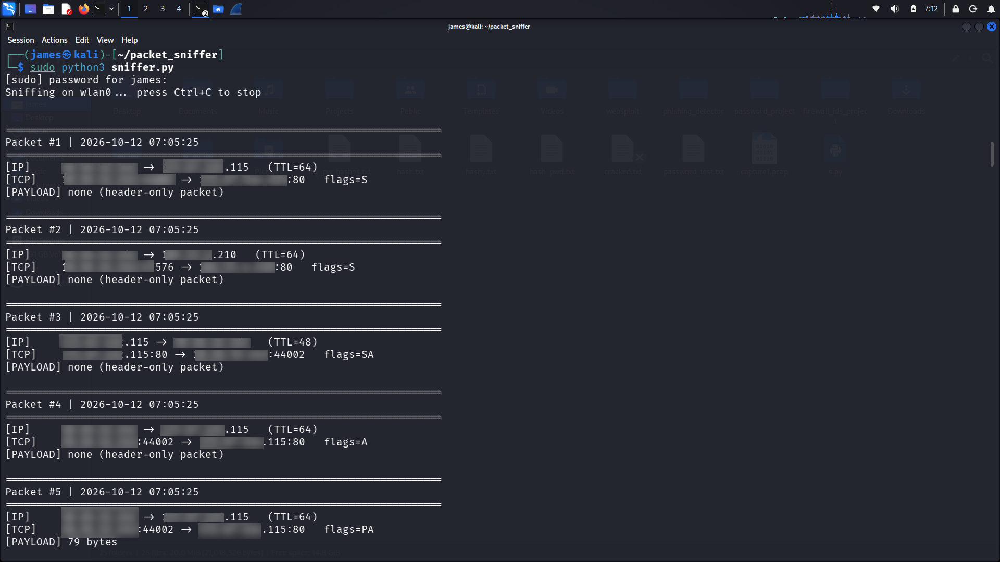
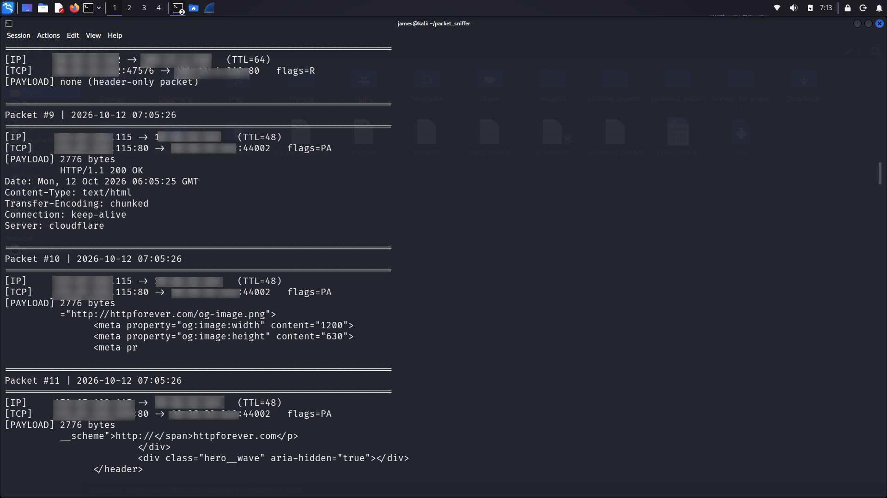
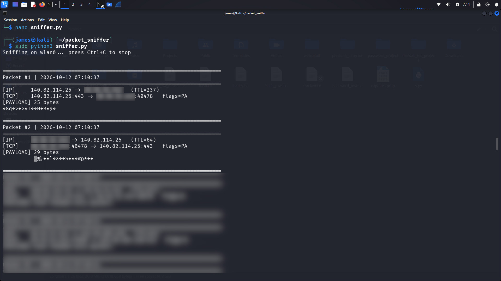
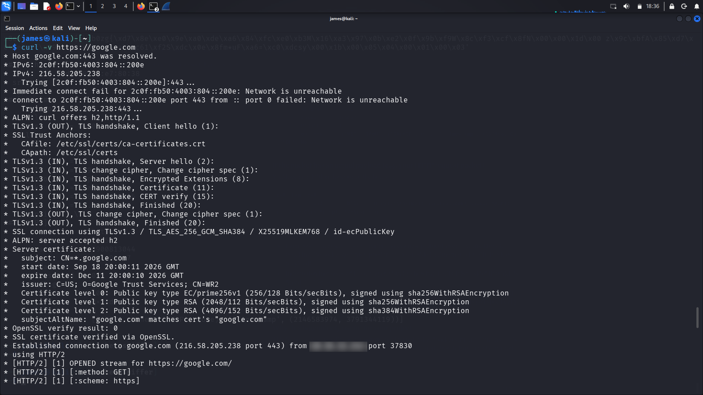
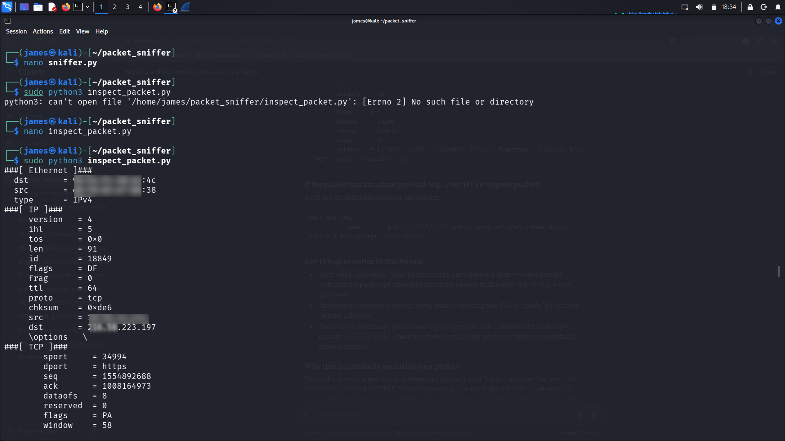
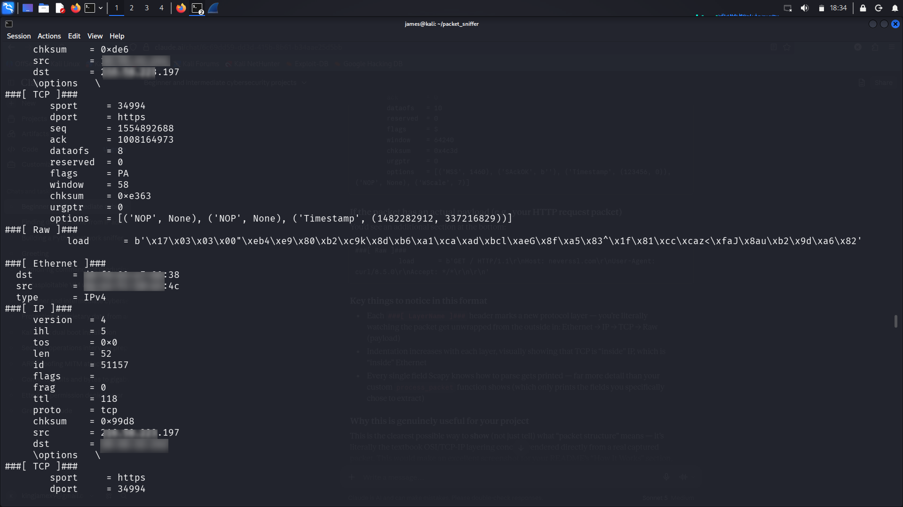

# Basic Network Sniffer with Python & Scapy

A Python-based packet sniffer built to capture and analyze live network
traffic, breaking packets down layer by layer (IP, transport protocol,
payload) to understand how data flows across a network.

## Tools Used
- Python3
- Scapy
- Kali Linux

## What It Does
- Captures live traffic on a chosen network interface
- Identifies protocol type: TCP, UDP, ICMP
- Displays source/destination IPs and ports
- Extracts and displays packet payloads where present

## How It Works
1. **Network layer (IP)** — source/destination addresses, TTL
2. **Transport layer (TCP/UDP/ICMP)** — ports, flags, protocol type
3. **Payload** — actual transmitted content, decoded where readable

## Key Findings
Testing against plain HTTP traffic showed full request/response content
in readable plaintext. The identical test against HTTPS traffic showed
only encrypted, unreadable byte sequences at the payload layer, despite
identical capture at the network/transport level, a direct demonstration
of what HTTPS protects against.

## Screenshots

## Ethical Note
All testing was performed exclusively on my own machine and personal
network. No other devices or networks were captured without authorization.
